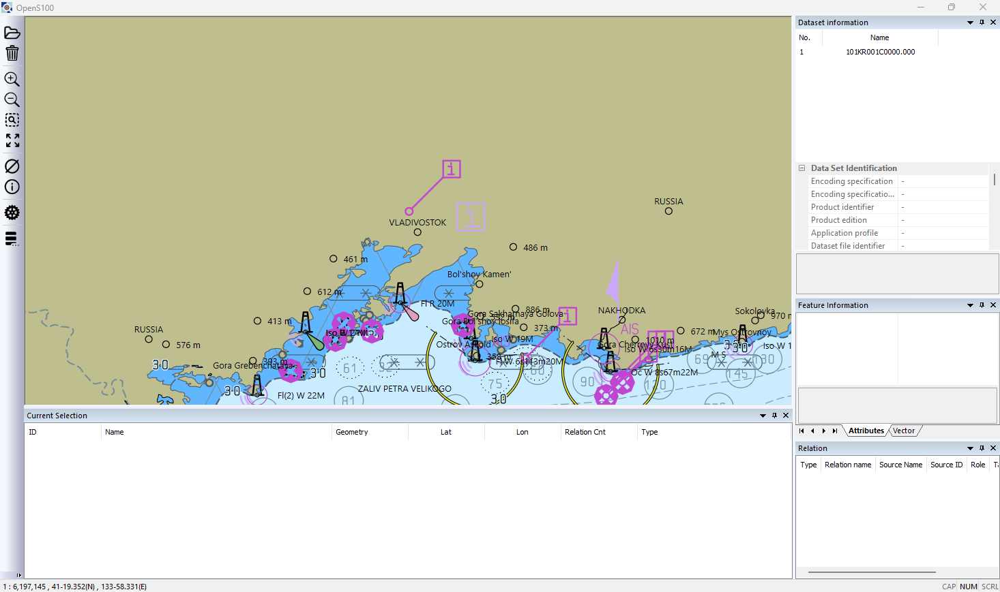

# 렌더 검증 기록 (2026-11-09)

Phase 1에서 그리기 코드를 여러 번 옮겼다(GDI 그리기 → `GdiGeometryRenderer`, D2D 뷰 변환 → `D2DView.h`,
`Scaler` API 변경, `/W4` 정리 등). 지침 23번대로 실제 화면으로 확인해야 하는 변경이다.

## 화면 캡처는 처음에는 불가능했다

`agent-desktop`으로 뷰어를 띄우고 접근성 트리까지는 읽었지만 스크린숏은 실패했다
(`BitBlt failed for display capture`, PowerShell `CopyFromScreen`도 `The handle is invalid`).
원인은 사용자 세션이 원격 연결 해제 상태(`qwinsta` 기준 `Disc`)였기 때문이다. 연결이 끊긴 RDP 세션은
데스크톱을 그리지 않으므로 어떤 캡처 API도 동작하지 않는다. 세션이 연결되어 있을 때 다시 시도한다.

## 실제 화면 확인 (같은 날 오후, 세션 연결 상태)

세션이 연결된 뒤 `agent-desktop`으로 다시 확인했다. `Release_x64\OpenS100.exe`(Phase 1 완료 시점 빌드)에서
`101KR001C0000.000`을 열고 화면을 캡처했다.



육지·수심 구역 채움, 해안선, 등대 기호와 등질 문자열(`Fl R 20M`, `Iso W 19M`), 등광 호, 침선, 수심 숫자와 등심선 라벨,
지명(VLADIVOSTOK, NAKHODKA), 정보 기호와 지시선, 점선 경계가 모두 그려진다. 오프스크린 결과와 같은 모양이고 이상 징후는 없다.

자동화 방법(다음에 다시 할 때):

- 이 서버의 `agent-desktop`은 접근성 동작만 허용한다(마우스·키보드 입력 불가). 툴바 버튼은 이름이 없어 접근성으로 누를 수 없다.
- 그래서 앱의 명령을 직접 보낸다: 메인 창에 `WM_COMMAND`(`PostMessage(hwnd, 0x0111, id, 0)`). 명령 ID는 `resource.h`의
  `T1`(322, 열기) `T3`(324, 확대) `T4`(325, 축소) `T6`(327, 레이어에 맞춤).
- 열기 대화상자는 표준 대화상자라 접근성으로 다룬다: 파일 이름 입력란(automation id 1148)에 경로를 넣고 `Open`(id 1)을 누른다.
- 명령줄 인자로 준 데이터셋 경로는 열리지 않는다(`ProcessShellCommand`가 문서를 만들 뿐 레이어를 추가하지 않음). 뷰어 쪽은 열린다.

## 세션이 끊겨 있을 때를 위한 것: 오프스크린 렌더 테스트

`Tests/OpenS100Tests/RenderSmokeTest.cpp`

- 뷰어와 같은 경로(`CGISLibraryApp::Draw(HDC)`)로 그리되 대상이 32비트 메모리 비트맵이다.
  창도, 대화형 데스크톱도 필요 없다(연결이 끊긴 세션에서도 동작함을 확인).
- 결과를 PNG로 저장한다. 출력 위치는 환경 변수 `S100_RENDER_OUT`(없으면 테스트 임시 폴더).
- `RenderSmoke.DrawsKoreanS101CellOffscreen`: KOR_TDS의 가장 작은 셀을 그리고 "빈 화면이 아님"만 단언한다(약 1.3초).
- `RenderSmoke.DrawsCellsFromEnvironment`: `S100_RENDER_CELLS`(`;` 구분 경로)에 적은 셀을 그린다. 기본은 건너뜀.

```
cd Debug_x64
set S100_RENDER_OUT=C:\temp\render
set S100_RENDER_CELLS=D:\s100-reference\tds\KOR_TDS\S100_ROOT\S-101\DATASET_FILES\101KR005G3E12\101KR005G3E12.000
OpenS100Tests.exe --gtest_filter=RenderSmoke.*
```

픽셀 단위 골든 이미지 비교는 디스플레이 리스트 IR(Phase 3)과 함께 넣는다. 지금은 사람이나 에이전트가
PNG를 직접 보는 용도다.

## 이번 결과 (커밋 5466bc38 기준, Debug x64)

| 셀 | 이미지 | 확인한 것 |
|---|---|---|
| 101KR003G2M00 (먼바다) | `assets/2026-11-09-render-check/101KR003G2M00.png` | 수심 구역 채움, 영역 패턴, 수심 숫자, 지명 텍스트, 정보 심볼 |
| 101KR005G3E12 (통영 부근) | `assets/2026-11-09-render-check/101KR005G3E12.png` | 육지·수심 구역 색, 등심선, 등화 문자열(`Fl R 4s11m8M`), 부표·교량·항만 이름, 등광 부채꼴 |
| 101KR004F4H20 (광양·여수) | `assets/2026-11-09-render-check/101KR004F4H20.png` | 위와 같음 + 항로 표지 밀집 구역, 교통 분리·주의 구역 경계 |

이상 징후는 보이지 않았다. 셀 전체를 한 화면에 맞춰 그려서 텍스트와 심볼이 겹쳐 보이는 것은
축척 필터를 적용하지 않은 전체 보기라서 그렇다.

## 성능 기준선 (Release x64, 1600x1000 메모리 비트맵, 셀 전체 보기)

`RenderSmokeTest`가 단계별 시간을 출력한다(`[ timing ]` 줄).

| 셀 | 카탈로그 로드 | 열기+포트레이얼 | 첫 프레임 | 이후 프레임 4회 |
|---|---|---|---|---|
| 101KR003G2M00 | 85 ms | 10 ms | 478 ms | 13 / 13 / 13 / 13 ms |
| 101KR005G3E12 | 71 ms | 1,625 ms | 185 ms | 133 / 130 / 606 / 273 ms |
| 101KR004F4H20 | 210 ms | 2,746 ms | 385 ms | 818 / 277 / 754 / 282 ms |

- Debug 빌드는 같은 두 상세 셀에 336초가 걸렸다(반복자 디버깅 때문). 성능 판단은 Release로만 한다.
- 열기+포트레이얼(8211 파싱 + Lua 규칙 실행)이 셀당 1.6~2.7초로 가장 크다.
- 프레임 시간이 130~800 ms로 들쭉날쭉하다. 단조 증가는 아니므로 누적 버그는 아니지만, 상호작용에는 느리다.
  축척별 걸러내기·공간 색인이 없고 매 프레임 전체를 다시 그리기 때문이다. Phase 3(디스플레이 리스트 + Skia)의 목표 수치를 잡을 때 이 표를 기준으로 쓴다.
- 측정 환경이 연결 끊긴 원격 세션이라 Direct2D가 소프트웨어 경로였을 수 있다. 연결된 세션에서 한 번 더 잰다.
